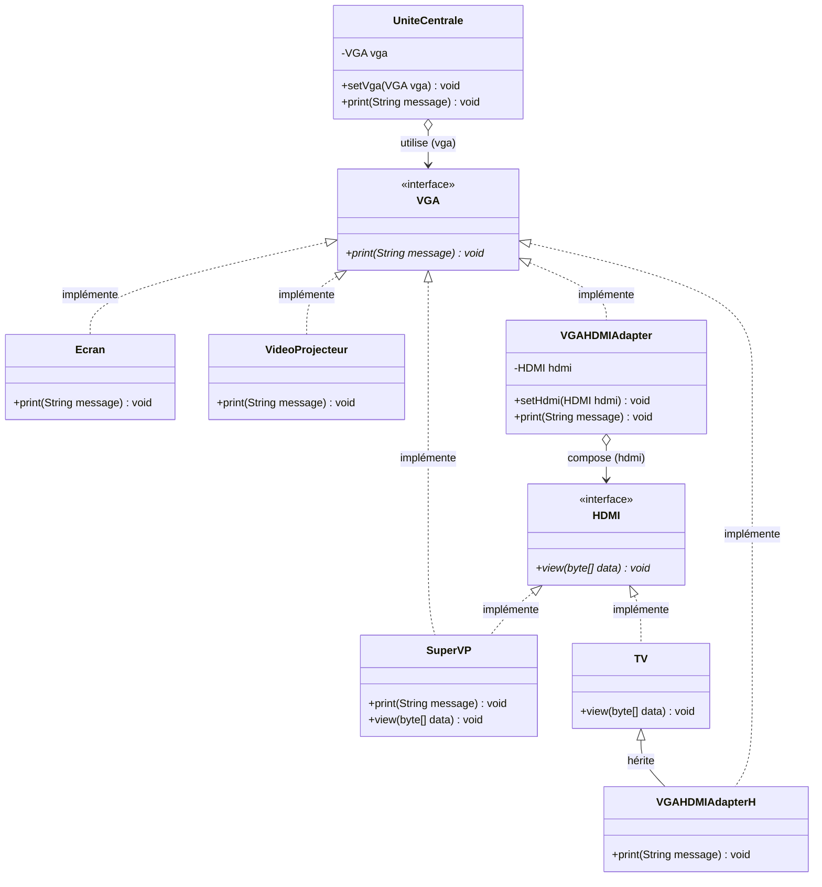
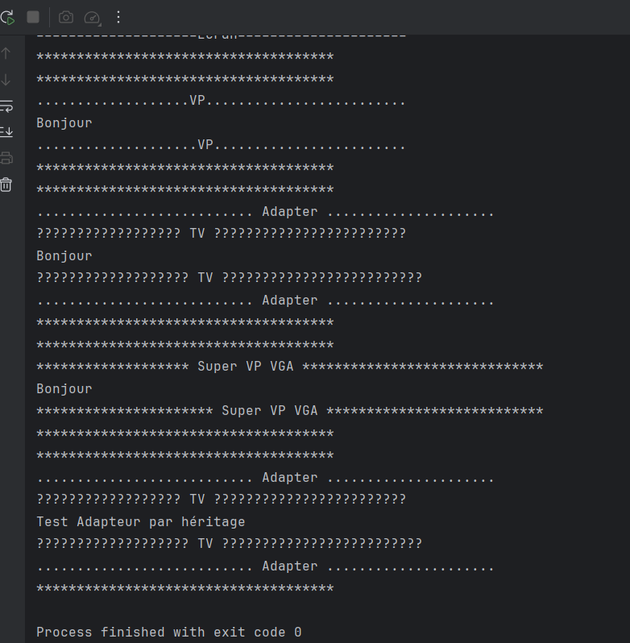

# Design Pattern Adapter (TP3)

Implémentation en Java du design pattern **Adapter**, réalisée dans le cadre du module Design Patterns (ENSET Mohammedia, cycle ingénieur GLSID).

Ce TP illustre l'intégration et l'interopérabilité entre composants aux interfaces incompatibles (standard **VGA** et standard **HDMI**) en mettant en œuvre les deux variantes canoniques du pattern : l'adaptateur par **composition** (adaptateur d'objets) et l'adaptateur par **héritage** (adaptateur de classes).

## Sommaire

- [Le pattern Adapter](#le-pattern-adapter)
- [Structure du projet](#structure-du-projet)
- [Diagramme de classes](#diagramme-de-classes)
- [Les deux approches de l'Adapter](#les-deux-approches-de-ladapter)
  - [1. Adaptateur d'objet (Composition)](#1-adaptateur-dobjet-composition)
  - [2. Adaptateur de classe (Héritage)](#2-adaptateur-de-classe-héritage)
  - [Tableau comparatif](#tableau-comparatif)
- [Programme de test](#programme-de-test)
- [Trace d'exécution](#trace-dexécution)
- [Exécution](#exécution)
- [Auteur](#auteur)

## Le pattern Adapter

Adapter est un pattern **structurel**. Son intention est de convertir l'interface d'une classe existante en une autre interface attendue par le client, afin de permettre à des classes de collaborer malgré des interfaces incompatibles.

Dans notre cas d'étude :
- Le **Client** est une **Unité Centrale** (`UniteCentrale`) qui envoie un flux vidéo textuel (`String`) via le protocole **VGA** (`print(String message)`).
- Certains périphériques d'affichage modernes comme les téléviseurs (**TV**) ne disposent que d'un port **HDMI** (`view(byte[] data)`), attendant des paquets d'octets binaires (`byte[]`).
- L'**Adapter** fait office de passerelle matérielle/logicielle : il implémente l'interface cible `VGA`, convertit le message `String` en tableau d'octets `byte[]`, puis délègue le rendu au port `HDMI`.

Cas d'usage typiques : intégration de bibliothèques tierces (*legacy* ou propriétaires), couches d'accès aux données (ORM/Drivers), convertisseurs de protocoles réseau ou graphiques.

## Structure du projet

```
src/main/java/net/zoungrana
├── adapter/
│   ├── VGAHDMIAdapter.java    adaptateur d'objets (par composition)
│   └── VGAHDMIAdapterH.java   adaptateur de classes (par héritage)
├── computer/
│   ├── VGA.java               interface cible attendue par le client (Target)
│   ├── HDMI.java              interface du composant à adapter (Adaptee Interface)
│   ├── UniteCentrale.java     client émetteur (Client)
│   ├── Ecran.java             afficheur compatible natif VGA
│   ├── VideoProjecteur.java   vidéoprojecteur compatible natif VGA
│   ├── TV.java                téléviseur HDMI incompatible nativement (Adaptee)
│   └── SuperVP.java           périphérique hybride compatible VGA et HDMI
└── Main.java                  programme de test démontrant toutes les configurations
```

| Élément | Type GoF | Rôle |
|---|---|---|
| `VGA` | *Target* | Interface standard cible exposant `void print(String message)`. |
| `HDMI` | *Adaptee Interface* | Interface concurrente/moderne exposant `void view(byte[] data)`. |
| `UniteCentrale` | *Client* | Machine cliente couplée exclusivement à l'interface `VGA`. Déclenche `vga.print(message)`. |
| `Ecran` | *Concrete Target* | Écran classique implémentant directement `VGA`. |
| `VideoProjecteur` | *Concrete Target* | Vidéoprojecteur implémentant directement `VGA`. |
| `TV` | *Adaptee* | Téléviseur haute définition n'implémentant que `HDMI`. |
| `SuperVP` | *Hybrid Component* | Vidéoprojecteur avancé implémentant simultanément `VGA` et `HDMI`. |
| `VGAHDMIAdapter` | *Object Adapter* | Adaptateur basé sur la **composition** : implémente `VGA` et référence une instance de `HDMI`. |
| `VGAHDMIAdapterH` | *Class Adapter* | Adaptateur basé sur l'**héritage** : hérite de `TV` et implémente `VGA`. |
| `Main` | *Client Test* | Scénario complet testant les périphériques directs et les deux adaptateurs. |

## Diagramme de classes




Lecture du diagramme :

- **`UniteCentrale` dépend de l'interface `VGA`** : couplage faible respectant le principe d'inversion des dépendances (*DIP*). L'unité centrale peut dialoguer avec n'importe quel périphérique pourvu qu'il implémente `VGA`.
- **`Ecran` et `VideoProjecteur` implémentent directement `VGA`** : ils sont immédiatement utilisables sans adaptation.
- **`TV` implémente `HDMI`** : ses signatures de méthode (`view(byte[])`) la rendent incompatible avec l'attribut `VGA` de l'unité centrale.
- **`SuperVP` est bi-mode** : implémentant à la fois `VGA` et `HDMI`, il peut être connecté en VGA direct ou via un câble HDMI.
- **`VGAHDMIAdapter` (Composition)** : implémente `VGA` et possède un attribut `private HDMI hdmi`. Il adapte **n'importe quel** équipement HDMI (polymorphisme de l'interface `HDMI`).
- **`VGAHDMIAdapterH` (Héritage)** : hérite directement de la classe concrète `TV` et implémente `VGA`.

## Les deux approches de l'Adapter

### 1. Adaptateur d'objet (Composition)

Dans cette approche (`VGAHDMIAdapter`), l'adaptateur implémente l'interface cible `VGA` et maintient une référence d'agrégation/composition vers l'interface `HDMI` :

```java
public class VGAHDMIAdapter implements VGA {
    private HDMI hdmi;

    @Override
    public void print(String message) {
        System.out.println("........................... Adapter .....................");
        byte[] data = message.getBytes();
        hdmi.view(data);
        System.out.println("........................... Adapter .....................");
    }

    public void setHdmi(HDMI hdmi) {
        this.hdmi = hdmi;
    }
}
```

**Forces de l'adaptateur d'objet :**
- **Flexibilité polymorphique** : l'adaptateur peut collaborer avec **toute classe** implémentant `HDMI` (`TV`, `SuperVP`, ou de futurs écrans).
- **Remplacement dynamique à l'exécution** : via le setter `setHdmi(HDMI)`, on peut brancher un nouvel équipement HDMI à chaud.
- Conforme à la règle GoF : *"Favor object composition over class inheritance"*.

### 2. Adaptateur de classe (Héritage)

Dans cette approche (`VGAHDMIAdapterH`), l'adaptateur hérite directement de la classe concrète de l'adaptee (`TV`) et implémente l'interface cible `VGA` :

```java
public class VGAHDMIAdapterH extends TV implements VGA {

    @Override
    public void print(String message) {
        System.out.println("........................... Adapter .....................");
        byte[] data = message.getBytes();
        super.view(data);
        System.out.println("........................... Adapter .....................");
    }
}
```

**Caractéristiques de l'adaptateur de classe :**
- **Simplicité d'instanciation** : aucun besoin d'instancier un objet `TV` séparé ; l'adaptateur *est lui-même* une `TV`.
- **Couplage fort et statique** : l'adaptateur est figé sur la classe `TV`. Il est incapable d'adapter une autre implémentation HDMI sans écrire une nouvelle sous-classe dédiée.
- En Java (qui ne supporte pas l'héritage multiple de classes), l'adaptateur ne peut étendre qu'une seule classe concrète à la fois.

### Tableau comparatif

| Critère | Adaptateur d'Objet (`VGAHDMIAdapter`) | Adaptateur de Classe (`VGAHDMIAdapterH`) |
|---|---|---|
| Mécanisme | **Composition** (`has-a` `HDMI`) | **Héritage** (`is-a` `TV`) |
| Couplage | Faible (dépend de l'interface `HDMI`) | Fort (lié à la classe concrète `TV`) |
| Polymorphisme de l'adaptee | Oui (adapte `TV`, `SuperVP`, etc.) | Non (uniquement la classe `TV` et ses sous-classes) |
| Changement à chaud | Oui (via `setHdmi`) | Non (défini à l'instanciation) |
| Nombre d'objets en mémoire | 2 (l'adaptateur + l'adaptee) | 1 seul (l'adaptateur est l'adaptee) |
| Respect Open/Closed | Élevé | Limité |

## Programme de test

La classe `net.zoungrana.Main` met en scène l'ensemble des cas d'utilisation possibles :

```java
package net.zoungrana;

import net.zoungrana.adapter.VGAHDMIAdapter;
import net.zoungrana.adapter.VGAHDMIAdapterH;
import net.zoungrana.computer.*;

public class Main {
    public static void main(String[] args) {
        UniteCentrale uc = new UniteCentrale();

        // 1. Branchement d'un Écran VGA classique
        uc.setVga(new Ecran());
        uc.print("Bonjour");

        // 2. Branchement d'un Vidéoprojecteur VGA
        uc.setVga(new VideoProjecteur());
        uc.print("Bonjour");

        // 3. Branchement d'une TV HDMI via l'adaptateur par COMPOSITION
        VGAHDMIAdapter adapter = new VGAHDMIAdapter();
        adapter.setHdmi(new TV());
        uc.setVga(adapter);
        uc.print("Bonjour");

        // 4. Branchement d'un SuperVP hybride (port VGA direct)
        uc.setVga(new SuperVP());
        uc.print("Bonjour");

        // 5. Branchement via l'adaptateur par HÉRITAGE
        VGAHDMIAdapterH adapterH = new VGAHDMIAdapterH();
        uc.setVga(adapterH);
        uc.print("Test Adapteur par héritage");
    }
}
```

## Trace d'exécution



```text
*************************************
==================Ecran=======================
Bonjour
====================Ecran=====================
*************************************
*************************************
...................VP.........................
Bonjour
....................VP........................
*************************************
*************************************
........................... Adapter .....................
?????????????????? TV ????????????????????????
Bonjour
??????????????????? TV ?????????????????????????
........................... Adapter .....................
*************************************
*************************************
******************* Super VP VGA ******************************
Bonjour
********************** Super VP VGA ***************************
*************************************
*************************************
........................... Adapter .....................
?????????????????? TV ????????????????????????
Test Adapteur par héritage
??????????????????? TV ?????????????????????????
........................... Adapter .....................
*************************************

Process finished with exit code 0
```

| Étape | Périphérique configuré | Type d'accès | Sortie observée | Explication |
|:---:|---|---|---|---|
| **1** | `new Ecran()` | Natif VGA | `==================Ecran=======================` | Connexion directe sans adaptation. |
| **2** | `new VideoProjecteur()` | Natif VGA | `...................VP.........................` | Connexion directe sans adaptation. |
| **3** | `VGAHDMIAdapter` + `TV` | **Adaptateur Composition** | `... Adapter ...` $\rightarrow$ `??? TV ???` | L'adaptateur reçoit le message VGA, le convertit en `byte[]` et appelle `tv.view(data)`. |
| **4** | `new SuperVP()` | Natif VGA | `******************* Super VP VGA *************` | Utilisation du port VGA direct du SuperVP. |
| **5** | `VGAHDMIAdapterH` | **Adaptateur Héritage** | `... Adapter ...` $\rightarrow$ `??? TV ???` | L'adaptateur convertit le message et appelle `super.view(data)` directement sur lui-même. |

Points vérifiés par cette trace :

- **Transparence totale pour le client** : l'objet `UniteCentrale` n'appelle jamais que `vga.print(...)`. Il n'a aucune connaissance de l'existence de protocoles HDMI ou d'adaptateurs intermédiaires.
- **Conversion réussie des données** : le flux de type `String` envoyé par le port VGA est converti sans altération en tableau binaire `byte[]` puis re-transformé en texte à l'affichage sur la TV.
- **Validité des deux variantes de pattern** : l'adaptateur par composition et l'adaptateur par héritage produisent un résultat fonctionnel identique du point de vue de l'utilisateur final.

## Exécution

Prérequis : JDK 21 et Maven.

Compilation du projet :
```bash
mvn compile
```

Lancement du programme principal :
```bash
java -cp target/classes net.zoungrana.Main
```

Le projet peut également être ouvert dans IntelliJ IDEA et exécuté directement en lançant la classe `net.zoungrana.Main`.

## Auteur

Charly ZOUNGRANA — Élève ingénieur en Génie Logiciel et Systèmes Informatiques Distribués, ENSET Mohammedia.
